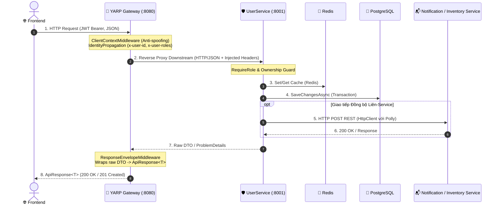

# System Flow Skill (Nexus 100% Synchronous RESTful Architecture)

Kỹ năng chuyên biệt dùng để bóc tách, truy vết và giải thích toàn diện một luồng xử lý (End-to-End Flow) trong hệ sinh thái thương mại điện tử & đấu giá Project Nexus (kết nối giữa Frontend, ApiGateway, UserService, AuctionService, CatalogService, CommerceService,...).

> ⚠️ **LƯU Ý ĐẶC BIỆT (30/10/2026):** Toàn bộ các dịch vụ trong hệ thống **ĐÃ BỎ BẤT ĐỒNG BỘ** (không sử dụng RabbitMQ / MassTransit Outbox). Tương tác giữa các services hoàn toàn đồng bộ qua RESTful HTTP/JSON hoặc xử lý ngầm in-memory.

---

## 🎯 Khi Nào Kỹ Năng Này Được Kích Hoạt?

Bất cứ khi nào người dùng yêu cầu:
- `trace luồng [tên_tính_năng]` (ví dụ: `trace luồng đăng ký`, `trace luồng đặt giá đấu giá`, `trace luồng verify otp`, `trace luồng duyệt shop`...).
- `giải thích luồng [tính_năng] từ FE đến DB`
- `đọc luồng API [endpoint]`
- Hoặc dùng cú pháp ngắn: `@system-flow [tính_năng]`

---

## 🏛️ Quy Chuẩn Bóc Tách Luồng 6 Tầng Chuẩn YARP Gateway & RESTful

Khi giải thích bất kỳ luồng nào, AI bắt buộc phải phân tích theo đúng cấu trúc 6 tầng sau:

### 1. Tầng 1: Frontend (Client Interaction)
- **Màn hình / Component:** Tên màn hình UI hoặc Component kích hoạt (Form đăng ký, Đăng nhập, Hồ sơ Shop, Phòng đấu giá...).
- **Sự kiện kích hoạt:** Click button, Submit form, WebSocket push...
- **HTTP Request gửi đi:**
  - Method & URL: ví dụ `POST http://localhost:8080/api/v1/auth/register`
  - Headers: `Authorization: Bearer <Token>`, `Content-Type: application/json`.
  - Request Body (JSON mẫu chuẩn).

### 2. Tầng 2: YARP API Gateway (Edge Ingress & Protection :8080)
- **Tuyến định tuyến (YARP Route):** Match Path trong `Gateway/appsettings.json` và `specs/02_ROUTING_CATALOG.md` (ví dụ `auth-route`: `/api/v1/auth/{**catch-all}`, `user-me-route`: `/api/v1/me/{**catch-all}`, `sellers-route`: `/api/v1/sellers/{**catch-all}`).
- **Rào chắn bảo vệ biên (Edge Middleware Pipeline):**
  1. `ClientContextMiddleware`: Active Anti-Spoofing (chặn đứng client ngoài gửi header `x-user-*` $\rightarrow$ trả về HTTP 403 `FORBIDDEN_HEADER_SPOOFING`), chặn toàn bộ request chứa `/internal/` ($\rightarrow$ HTTP 404).
  2. `JwtBearerAuthentication`: Xác thực chữ ký số của JWT token.
  3. `Redis Rate Limiting`: Giới hạn tần suất gọi API qua Redis dùng chung.
  4. `ResponseEnvelopeMiddleware`: Đón bắt dữ liệu raw trả về từ microservice để bọc thành envelope chuẩn `ApiResponse<T>` / `ApiResponse<PagedData<T>>`.
  5. `IdentityPropagationTransform`: Trích xuất Claims từ JWT và tiêm an toàn các header xuống downstream (`x-user-id`, `x-user-email`, `x-user-roles`).

### 3. Tầng 3: Giao thức Mạng Downstream (100% RESTful HTTP/JSON)
- **Phương thức gọi:** YARP Reverse Proxy chuyển tiếp HTTP `GET`, `POST`, `PUT`, `PATCH`, `DELETE` (JSON payload).
- **URL Nội bộ (Docker Network):** `http://user-service:8001/api/v1/...` (Destination của `user-cluster`).
- **Header tiêm an toàn:** `x-user-id`, `x-user-email`, `x-user-roles`, `x-correlation-id` *(Đã bỏ hoàn toàn RBAC, không còn `x-user-permissions`)*.

### 4. Tầng 4: Microservice Đích — UserService (Clean Architecture Layers)
- **API Layer (`User.Api/Controllers/Public/*.cs`):** 
  - Điểm đón HTTP REST trên Server Kestrel port 8001 (7 Public Controllers: `AuthController`, `MeController`, `UsersController`, `SellerController`, `AdminUsersController`, `AdminRolesController`, `AdminSellerRegistrationsController`).
  - **Rào chắn phân quyền vai trò:** Sử dụng `[RequireRole("admin", "staff")]` và các tiện ích `EnsureOwnership()`, `EnsureRole()`, `EnsureAdmin()` trong `HttpContextExtensions.cs` để bảo vệ tài nguyên (không dùng RBAC ma trận permissions).
  - Validation dữ liệu đầu vào DTO (`ApiValidationProblemFactory`).
  - Gọi xuống Application Service qua DI.
- **Application Layer (`Services/*Service.cs`):**
  - Thực thi quy tắc nghiệp vụ (Business Rules).
  - Validation chi tiết (Email regex, độ dài mật khẩu, ngưỡng điểm uy tín $\ge 40$...).
  - Xử lý mã hóa bảo mật (BCrypt hash mật khẩu có Salt).
- **Domain Layer:**
  - Các Entity bị tác động (`User`, `SellerProfile`, `ReputationScore`, `UserRole`...).
  - Trạng thái thay đổi (`UserStatus.PendingVerification`, `TrustLevel.Standard`...).

### 5. Tầng 5: Tác động Hạ Tầng & Liên Service (Persistence & Inter-Service Sync)
- **Cơ sở dữ liệu PostgreSQL (`AppDbContext`):**
  - Liệt kê các bảng / DbSet bị tác động (`INSERT`, `UPDATE`, `DELETE`).
  - Đảm bảo tính toàn vẹn trong 1 Transaction (`SaveChangesAsync`).
- **Bộ nhớ đệm Redis Cache:**
  - Key cache nào được lưu, TTL bao lâu (ví dụ OTP 6 số lưu 5 phút `otp:{email}`, User cache).
- **Giao tiếp Liên Service Đồng bộ & Xử lý Nền (100% REST / In-Memory):**
  - *Hệ thống đã bỏ hoàn toàn RabbitMQ.*
  - Tương tác với service khác được thực hiện đồng bộ qua REST HTTP (ví dụ: UserService gọi NotificationService hoặc InventoryService).
  - Tác vụ gửi email OTP nếu xử lý nội bộ sẽ đẩy vào `Channel<T>` chạy ngầm qua `BackgroundService` hoặc Mock Log ở Dev.

### 6. Tầng 6: Đường Về & Phản Hồi Cho Client
- **Đóng gói ngược dữ liệu:** Entity $\rightarrow$ Service DTO $\rightarrow$ HTTP JSON Response từ UserService $\rightarrow$ Gateway đóng gói `ApiResponse<T>` chuẩn toàn sàn (`success`, `message`, `data`).
- **HTTP Status Code trả về:** 200 OK, 201 Created, hoặc mã lỗi RFC 9110 ProblemDetails nếu thất bại.

---

## 📊 Quy Chuẩn Trực Quan Hóa (Visualization Standard)

Mỗi lần giải thích một luồng, AI bắt buộc phải cung cấp:

### 1. Sơ đồ Sequence Mermaid Trực Quan (YARP Gateway & 100% Đồng bộ RESTful)

### 2. Ma Trận Mã Nguồn (Code Mapping Table)
Bảng tổng hợp tất cả các file tham gia vào luồng kèm **Clickable Markdown Link** với schema `file:///`:
| Tầng | Tên File | Đường dẫn Clickable Link | Vai trò cụ thể trong luồng |
| :--- | :--- | :--- | :--- |
| Gateway Route Catalog | `02_ROUTING_CATALOG.md` | [02_ROUTING_CATALOG.md](file:///c:/Users/ACER/Desktop/Gateway/specs/02_ROUTING_CATALOG.md) | Định tuyến Reverse Proxy YARP |
| Gateway Middleware | `ClientContextMiddleware.cs` | [ClientContextMiddleware.cs](file:///c:/Users/ACER/Desktop/Gateway/Gateway/Middlewares/ClientContextMiddleware.cs) | Anti-spoofing, chặn /internal/ |
| Gateway Transform | `IdentityPropagationTransform.cs` | [IdentityPropagationTransform.cs](file:///c:/Users/ACER/Desktop/Gateway/Gateway/Transforms/IdentityPropagationTransform.cs) | Tiêm x-user-id, x-user-roles |
| Gateway Envelope | `ResponseEnvelopeMiddleware.cs` | [ResponseEnvelopeMiddleware.cs](file:///c:/Users/ACER/Desktop/Gateway/Gateway/Middlewares/ResponseEnvelopeMiddleware.cs) | Đóng gói ApiResponse<T> |
| UserService Controller | `AuthController.cs` | [AuthController.cs](file:///c:/Users/ACER/Desktop/UserService/User.Api/Controllers/Public/AuthController.cs) | Controller REST đón request |
| UserService Auth Guard | `RequireRoleAttribute.cs` | [RequireRoleAttribute.cs](file:///c:/Users/ACER/Desktop/UserService/User.Api/Filters/RequireRoleAttribute.cs) | Rào chắn phân quyền vai trò |
| Application Core | `AuthService.cs` | [AuthService.cs](file:///c:/Users/ACER/Desktop/UserService/User.Application/Services/Auth/AuthService.cs) | Logic nghiệp vụ, hash mật khẩu |
| Persistence | `AppDbContext.cs` | [AppDbContext.cs](file:///c:/Users/ACER/Desktop/UserService/User.Infrastructure/Persistence/AppDbContext.cs) | Lưu DB PostgreSQL |
| Cache | `RedisOtpService.cs` | [RedisOtpService.cs](file:///c:/Users/ACER/Desktop/UserService/User.Infrastructure/Services/Redis/RedisOtpService.cs) | Lưu OTP 5 phút |

---

## 📝 Tùy Chọn Xuất Ra Obsidian Vault (Mentor Workflow)

Khi người dùng yêu cầu lưu lại tài liệu học tập, hệ thống áp dụng cấu trúc **Kiềng 3 Chân (3-Pillar Knowledge Base)**:
- **Luồng nghiệp vụ:** Lưu vào `D:/obsidian/vinhth/UserService - học/Flows/YYYY-MM-DD_flow_[ten-luong].md`
- **Khái niệm lý thuyết phát sinh:** Tách riêng vào `D:/obsidian/vinhth/UserService - học/Concepts/YYYY-MM-DD_[ten-khai-niem].md`
- **Sự cố gặp phải (nếu có):** Lưu vào `D:/obsidian/vinhth/UserService - học/Troubleshooting/`
- **Liên kết 2 chiều:** Sử dụng cú pháp Obsidian Wikilink `[[...]]` kết nối trực tiếp giữa Luồng, Khái niệm và Sự cố để tạo mạng lưới tri thức trực quan trong **Graph View**.
